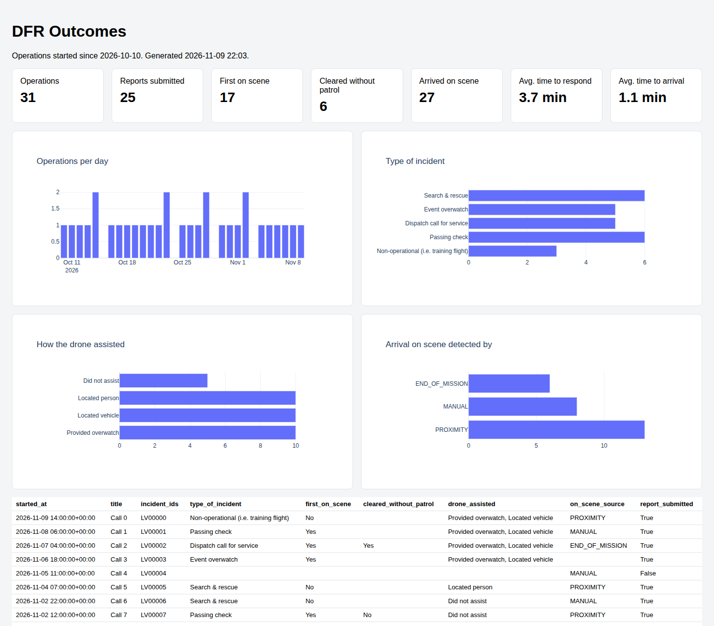

# DFR Outcomes Dashboard

Exports the DFR outcomes from operation reports, and the on-scene response times from the
operation timeline, to a CSV file and a single-file HTML dashboard. The HTML includes Plotly, so
it opens offline in any browser. Re-run the script to refresh it.



See the [Operations examples README](../README.md) for setup and the API token scopes required.

## Usage

Run from the `python-operations` folder:

```bash
python dfr_outcomes_dashboard/main.py --since 2026-10-01 --csv dfr_outcomes.csv --html dfr_outcomes.html
```

All arguments are optional. `--since` defaults to 30 days ago, and the output files to
`dfr_outcomes.csv` and `dfr_outcomes.html` in the current directory.

## Output

The script loads every operation started since `--since` and its latest submitted report, and
writes one CSV row per operation:

| Column | Source |
|--------|--------|
| `operation_id`, `title`, `incident_ids` | The operation |
| `started_at` | `OPERATION_CREATED` event |
| `time_to_respond_s` | `INCIDENT_CREATED` to `INCIDENT_RESPONDED` ("Respond" selected in Flight Deck) |
| `time_to_arrival_s` | `INCIDENT_RESPONDED` to `VEHICLE_ARRIVED_ON_SCENE` |
| `on_scene_source` | How the arrival was detected: `MANUAL`, `PROXIMITY` or `END_OF_MISSION` |
| `report_submitted` | Whether the operation has a submitted report |
| `type_of_incident` | "Type of incident" |
| `first_on_scene` | "Did the drone get to the scene first?" |
| `cleared_without_patrol` | "Did the drone clear the call without patrol resources?" |
| `drone_assisted` | "How did the drone assist with the call?" |

The dashboard shows totals and averages over those rows, bar charts of the answers, and a table
of the most recent operations. Report answers are matched on question title; questions your
organization added to its report are not included, but `get_operation.py` prints them.

The Skydio Cloud DFR Outcomes page applies more rules than this example, for example excluding
reports marked as training, so its numbers can differ. Change `write_html` to compute the stats
your team needs.
